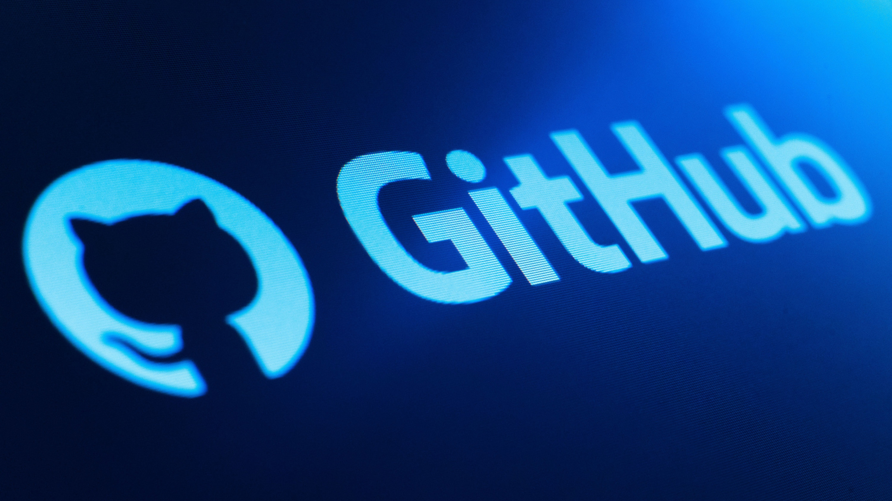

 <!-- ANURAG VERMA | PROFESSIONAL ANIMATED GITHUB PROFILE -->

  

   

  

  <h3>Full Stack Developer | MERN Stack | Java & DSA</h3>

  

    Building practical web applications with clean code, thoughtful design,
    and reliable backend systems.
  

  

    
    
    
  

  

---

## 👨‍💻 About Me

- 🎓 B.Tech student at IMS Engineering College.
- 💻 Focused on full-stack development using the MERN stack.
- ⚙️ Learning backend architecture, REST APIs, authentication, and database design.
- ☕ Practicing Data Structures and Algorithms using Java.
- 🚀 Building practical applications that solve real-world problems.
- 🎯 Interested in Software Developer, Backend Developer, and MERN Stack Developer opportunities.

---

## 🛠️ Tech Stack & Tools

### Frontend Development

### Backend Development & Databases

### Programming Languages

### Tools & Platforms

---

## 🚀 Featured Projects

### 1. InterviewIQ — Interview Preparation Platform

A web application focused on technical interview practice and interview preparation.

- **Focus:** Full-stack development and AI integration.
- **Technologies:** MERN stack and Gemini, where implemented.
- **Goal:** Make interview practice more accessible and structured.

🔗 [Explore my repositories](https://github.com/anuragverma16?tab=repositories)

### 2. Savoria — Restaurant Ordering Platform

A restaurant ordering and management application designed to streamline digital restaurant workflows.

- **Focus:** Customer ordering and restaurant management.
- **Technologies:** React, Node.js, Express, and MongoDB.
- **Goal:** Deliver a smooth digital ordering experience.

🔗 [Explore my repositories](https://github.com/anuragverma16?tab=repositories)

### 3. Enterprise Quality Assurance and Optimizer Engine

A content evaluation platform designed to analyze written content and recommend improvements.

- **Focus:** Content quality assessment and optimization.
- **Technologies:** React, FastAPI, NLP tools, and databases.
- **Goal:** Support structured content review and improvement.

🔗 [Explore my repositories](https://github.com/anuragverma16?tab=repositories)

---

## 📊 GitHub Analytics

  

  

    

  

---

## 📈 Contribution Activity

  

---

## 🎯 Currently Focusing On

| Area | Current Focus |
|:---|:---|
| Backend | Node.js, Express.js, REST APIs |
| Databases | MongoDB, MySQL |
| Authentication | JWT and secure authentication fundamentals |
| DSA | Java and problem-solving patterns |
| Development | Full-stack projects and clean code |
| Career | Preparing for entry-level software development roles |

---

## 🤝 Connect With Me

  
  
  

    

  

   

  **Thanks for visiting my profile! ⭐**

<!-- END OF PROFILE README --> 
