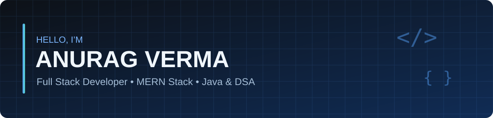

<!-- ANURAG VERMA | PROFESSIONAL ANIMATED GITHUB PROFILE -->

<div align="center">

  

  <br/><br/>

  

  <h3>💻 Full Stack Developer | MERN Stack | Java & DSA</h3>

  <p>
    Passionate about building scalable web applications, creating
    reliable backend systems, and solving real-world problems
    through clean and efficient code.
  </p>

  <p>
    <a href="https://github.com/anuragverma16">
      
    </a>
    <a href="https://www.linkedin.com/in/anurag-verma-60b726294/">
      
    </a>
    <a href="https://portfolio-anuragverma.vercel.app/">
      
    </a>
  </p>

  

  

</div>

---

## 👨‍💻 About Me

- 🎓 B.Tech student at **IMS Engineering College**.
- 💻 Full Stack Developer focused on the **MERN Stack**.
- ⚙️ Interested in backend architecture, REST APIs, and database design.
- 🔐 Learning authentication, authorization, and secure backend development.
- ☕ Practicing **Data Structures and Algorithms using Java**.
- 🤖 Exploring AI integration in modern web applications.
- 🚀 Building practical projects that solve real-world problems.
- 🤝 Open to open-source contributions and collaborative development.
- 🎯 Interested in Software Developer, Backend Developer, and MERN Stack Developer opportunities.

---

## 🧑‍💻 Developer Profile

| 👨‍💻 Profile | 📌 Details |
|:---|:---|
| **Name** | Anurag Verma |
| **Education** | B.Tech — IMS Engineering College |
| **Developer Role** | Full Stack / MERN Stack Developer |
| **Primary Stack** | MongoDB, Express.js, React.js, Node.js |
| **Programming Languages** | Java, JavaScript |
| **Backend Interests** | REST APIs, Authentication, System Design |
| **Databases** | MongoDB, MySQL |
| **Current Learning** | Backend Architecture, Java DSA, AI Integration |
| **Project Interests** | Full Stack, Backend, AI-Powered Applications |
| **Collaboration** | Open Source & Team Projects |
| **Career Interests** | Software Developer, Backend Developer |
| **Portfolio** | [Visit Website](https://portfolio-anuragverma.vercel.app/) |

---

## 🛠️ Tech Stack & Tools

<div align="center">

### 🎨 Frontend Development


### ⚙️ Backend Development & Databases


### ☕ Programming Languages


### 🧰 Tools & Platforms


</div>

---

## 🚀 Featured Projects

### 🎯 1. InterviewIQ — Interview Preparation Platform

A web application designed to make technical interview preparation more structured, interactive, and accessible.

**Project Highlights:**
- Technical interview preparation and practice.
- Full-stack application development.
- AI integration for interview-related features, where implemented.
- Focus on improving the interview preparation experience.

**Technologies:** MERN Stack, Gemini API (where implemented).

**Goal:** Help students and developers prepare for technical interviews.

🔗 [Explore My GitHub Repositories](https://github.com/anuragverma16?tab=repositories)

---

### 🍽️ 2. Savoria — Restaurant Ordering Platform

A full-stack restaurant ordering and management application focused on simplifying digital restaurant operations.

**Project Highlights:**
- Customer-focused ordering workflows.
- Restaurant management functionality.
- Frontend and backend integration.
- Database-driven application architecture.

**Technologies:** React.js, Node.js, Express.js, MongoDB.

**Goal:** Deliver a smooth and efficient digital restaurant ordering experience.

🔗 [Explore My GitHub Repositories](https://github.com/anuragverma16?tab=repositories)

---

### 📊 3. Enterprise Quality Assurance and Optimizer Engine

A content evaluation and optimization platform designed to analyze written content and support structured improvements.

**Project Highlights:**
- Content quality assessment.
- NLP-based analysis and evaluation.
- Content optimization recommendations.
- Web interface and backend integration.

**Technologies:** React.js, FastAPI, NLP Tools, Databases.

**Goal:** Help users evaluate and improve written content through structured analysis.

🔗 [Explore My GitHub Repositories](https://github.com/anuragverma16?tab=repositories)

---

## 🌟 Open to Collaboration

<div align="center">

### 🤝 Let's Build Something Meaningful Together!

I'm always interested in connecting with passionate developers,
exploring new technologies, and contributing to projects
that solve real-world problems.

**💡 Open to collaborating on:**

</div>

- 🚀 **Full Stack Web Applications** — Scalable applications using React, Node.js, Express.js, and MongoDB.
- 🤖 **AI-Powered Applications** — Integrating AI APIs, intelligent automation, and practical AI features.
- ⚙️ **Backend Development** — REST APIs, authentication systems, server-side architecture, and database integration.
- 🌐 **Open Source Projects** — Contributing features, fixing bugs, improving documentation, and learning from other developers.
- 🛒 **E-Commerce Platforms** — Product management, authentication, shopping carts, and ordering systems.
- 📊 **Developer Tools & Dashboards** — Analytics platforms, productivity tools, and admin dashboards.
- 🎓 **Student & Educational Platforms** — Learning management systems, interview preparation tools, and coding platforms.

<div align="center">

<a href="https://github.com/anuragverma16">
  
</a>

<a href="https://www.linkedin.com/in/anurag-verma-60b726294/">
  
</a>

</div>

---

## 💼 What I Can Contribute

| Area | Skills & Contributions |
|:---|:---|
| 🎨 Frontend | Responsive interfaces, React components, Tailwind CSS |
| ⚙️ Backend | REST API development, Node.js, Express.js |
| 🗄️ Databases | MongoDB, MySQL, database integration |
| 🔐 Authentication | JWT authentication, authorization fundamentals |
| 🔗 Integration | Third-party APIs, frontend-backend integration |
| 🧪 Testing | API testing and debugging with Postman |
| 🚀 Deployment | Vercel, Netlify, deployment workflows |
| 🤝 Teamwork | Git, GitHub, collaboration and code reviews |

---

## 🔭 What I'm Currently Working On

```javascript
const anurag = {
  name: "Anurag Verma",

  role: "Full Stack Developer",

  education: "B.Tech | IMS Engineering College",

  technologies: {
    frontend: [
      "React.js",
      "JavaScript",
      "HTML",
      "CSS",
      "Tailwind CSS"
    ],

    backend: [
      "Node.js",
      "Express.js",
      "FastAPI"
    ],

    databases: [
      "MongoDB",
      "MySQL"
    ],

    languages: [
      "Java",
      "JavaScript"
    ],

    tools: [
      "Git",
      "GitHub",
      "Postman",
      "VS Code",
      "Vercel"
    ]
  },

  currentlyLearning: [
    "Backend Architecture",
    "REST API Design",
    "Authentication & Authorization",
    "Data Structures & Algorithms",
    "System Design Fundamentals"
  ],

  collaborationInterests: [
    "MERN Stack Applications",
    "Open Source Projects",
    "Backend APIs",
    "AI Integrated Web Apps"
  ],

  careerGoal: "Become a skilled Software Engineer",

  motto: "Learn. Build. Improve. Repeat."
};
```

---

## 📚 Learning Roadmap

| Technology / Skill | Current Focus |
|:---|:---|
| ⚛️ React.js | Building reusable components |
| 🟢 Node.js & Express | REST APIs and backend architecture |
| 🍃 MongoDB | Database design and queries |
| 🔐 Authentication | JWT, authorization, security fundamentals |
| ☕ Java DSA | Problem solving and algorithms |
| 🏗️ System Design | Learning scalable application fundamentals |
| 🤖 AI Integration | Exploring AI-powered application features |
| 🧪 Testing | API testing and debugging |

---

## 🏆 Developer Goals

- 🎯 Build production-ready full-stack applications.
- 🧠 Strengthen Java DSA and problem-solving skills.
- 🌍 Make meaningful open-source contributions.
- ⚙️ Learn scalable backend architecture and system design.
- 🤝 Collaborate with developers on impactful projects.
- 💼 Prepare for software engineering internships and entry-level roles.
- 🚀 Continuously improve code quality and development practices.

---

## 📊 GitHub Analytics

<div align="center">


<br/><br/>


</div>

---

## 📈 Contribution Activity

<div align="center">


</div>

---

## 🐍 GitHub Contribution Snake

<!-- The local SVG works immediately. GitHub Actions replaces it with your real contribution snake after the first successful run. -->

<div align="center">


</div>

---

## 💬 Ask Me About

<div align="center">


</div>

Feel free to reach out about MERN development, backend APIs, student projects, or open-source collaboration.

---

## 🎯 Currently Focusing On

| Area | Current Focus |
|:---|:---|
| Backend | Node.js, Express.js, REST APIs |
| Databases | MongoDB, MySQL |
| Authentication | JWT and secure authentication fundamentals |
| DSA | Java and problem-solving patterns |
| Development | Full-stack projects and clean code |
| Career | Preparing for entry-level software development roles |

---

## 📬 Let's Connect & Collaborate

<div align="center">

### 🚀 Have an Interesting Project Idea?

Whether you're building a startup, working on an open-source
project, or looking for a development teammate, I'd love to
connect and explore opportunities to build together.

<a href="https://github.com/anuragverma16">
  
</a>

<a href="https://www.linkedin.com/in/anurag-verma-60b726294/">
  
</a>

<a href="https://portfolio-anuragverma.vercel.app/">
  
</a>

<br/><br/>


<br/>

**⭐ Explore my repositories and feel free to connect for collaboration!**

**Thanks for visiting my profile! 🚀**

</div>

<!-- END OF PROFILE README -->
